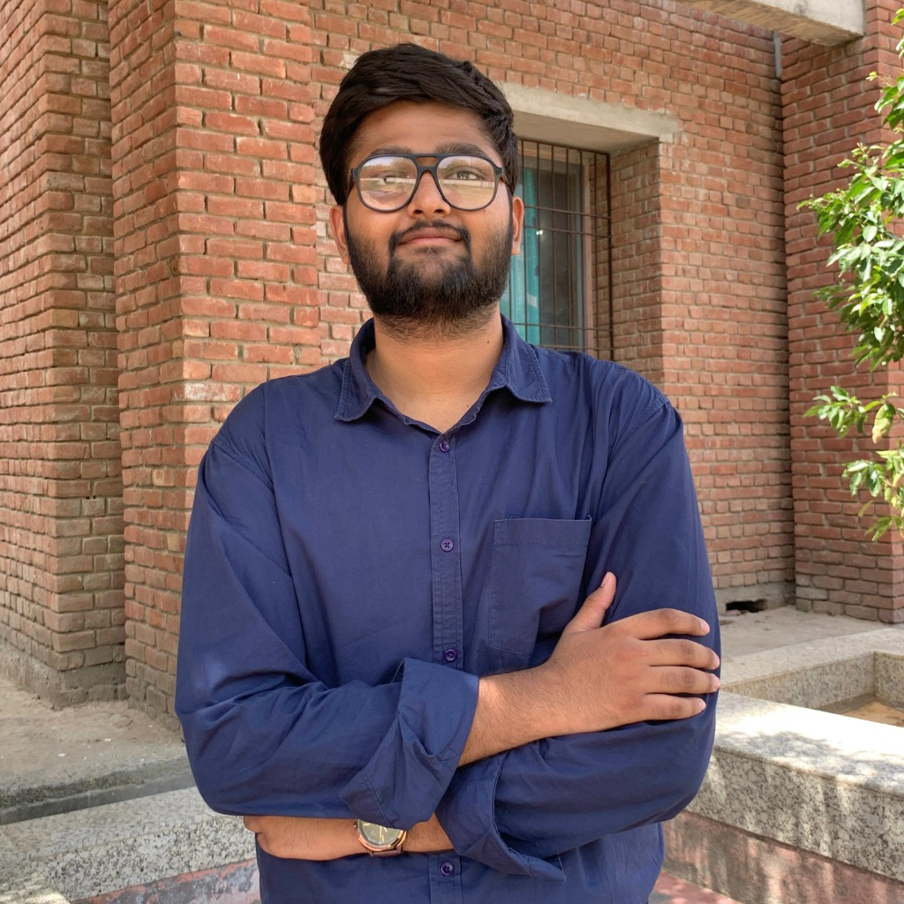

# NEXUS // OS — Futuristic Portfolio Operating System

A next-generation personal portfolio website inspired by futuristic desktop operating systems. Built with clean, modular HTML5, CSS3, and modern vanilla JavaScript with zero external build dependencies.

---

## 🚀 Key Features

- **Liquid Blob Custom Cursor:**
  - An organic, fluid digital blob that dynamically tracks the cursor with spring-damped trailing physics.
  - Multi-colour gradient core blending electric blue, cyan, soft violet, and subtle teal with an inner glass highlight and restrained glow.
  - Organic continuous morphing border-radius and directional velocity stretch when moving quickly across the screen.
  - Magnetic elastic expansion when hovering over buttons, dock items, and interactive links.
  - Droplet squish and ripple pulse feedback on mouse down / click.
  - Automatically disabled on touch screens and mobile devices for native touch interaction.

- **Sophisticated Multi-Colour Futuristic Aesthetic:**
  - Deep midnight navy (`#070d1e`, `#0b142c`) and charcoal (`#03050c`, `#050814`) base palette.
  - Electric-blue (`#0070f3`) and neon cyan (`#00f0ff`) primary highlights.
  - Soft violet (`#8b5cf6`, `#a78bfa`) and indigo (`#6366f1`) secondary accents.
  - Subtle teal (`#14b8a6`, `#2dd4bf`) for selected states and success indicators.
  - Crisp white (`#ffffff`) and cool grey (`#cbd5e1`, `#94a3b8`) for readable typography.
  - Glassmorphic translucent surfaces with `backdrop-filter: blur(20px)`.
  - Dynamic canvas background with a 3D perspective cyber horizon grid, multi-colour particle constellation, and subtle mouse-based parallax.

- **Hero Landing Home Page:**
  - The first screen visitors see upon landing on your portfolio.
  - **Left Side:**
    - Live system status badge: `SYSTEM ONLINE // PORTFOLIO INITIALIZED`.
    - Prominent heading: `Hi, I'm Suyash Agrawal.` with luminous electric-blue-to-violet gradient typography.
    - Professional tagline: `Beyond Code. Into Intelligence.`.
    - Short introduction: B.Tech student in Artificial Intelligence & Data Science at JECRC University.
    - Action buttons:
      * **"Explore My Work"** (opens the Projects window).
      * **"Contact Me"** (opens the Contact window).
    - Social channel placeholders (GitHub, LinkedIn, Email/Comm).
  - **Right Side:**
    - Profile photograph of Suyash Agrawal framed with futuristic HUD corner brackets and multi-layer breathing cyan & violet glows.
    - **Holographic Energy Pulse on Click:**
      * Emits 3 concentric holographic rings expanding outward and fading smoothly with electric blue, cyan, and violet gradients.
      * Central radial light pulse and 8 dispersing micro-particles.
      * High-tech synthesized audio micro-tone feedback.
      * Built-in 820ms throttle to prevent overlapping on rapid clicks.
    - **Interactive Hover State:**
      * Smooth slight photo enlargement (`scale(1.045)`).
      * Intensified cyan & violet spatial ambient glow.
      * Subtle diagonal reflective holographic sheen sweep.
    - Accessible: Full keyboard trigger (`Enter` / `Space`) and `prefers-reduced-motion` safety.

- **Streamlined Top Status Bar:**
  - OS branding on the left (`SUYASH AG.`) with cyan accent and live status pill.
  - Quick action controls on the right: Synthesized Audio toggle, Command Palette shortcut button (`Ctrl+K`), Fullscreen toggle, and live digital Clock with Date.
  - Clean and balanced layout without CPU/RAM meters.

- **Floating Bottom Dock:**
  - Glassmorphism bottom dock for navigating to all portfolio sections.
  - Smooth cursor proximity magnification (cosine scaling curve).
  - Multi-colour active indicators (cyan for open, soft violet for minimized, teal for focused).
  - Tooltip badges on hover.
  - Clicking "Home" minimizes active windows to reveal the Home Hero page.

- **Draggable & Resizable Application Windows:**
  - Fully draggable with boundaries checking.
  - Resizable with corner and edge handles.
  - Native-style window controls: **Close**, **Minimize** (animates to dock), and **Maximize / Restore**.
  - Dynamic z-index layering (clicking any window brings it to focus).
  - Tiling and cascading algorithms for organizing open windows.

- **Command Palette (`Ctrl+K` or `Cmd+K`):**
  - Instant searchable modal with keyboard navigation (`↑`, `↓`, `Enter`, `Esc`).
  - Search and open any portfolio section, return to Home, or trigger system actions.

- **Synthesized UI Audio (Web Audio API):**
  - Subtle, high-tech acoustic feedback for window opening, closing, minimizing, and hovering.
  - Zero external sound files required — pure synthesized micro-tones.
  - Easily toggleable via the status bar button or Command Palette.

- **Mobile & Tablet Responsive Mode:**
  - The hero section automatically stacks vertically on smaller screens with the profile photo centered.
  - Windows adapt into full-screen mobile OS modal sheets with touch-friendly controls.
  - Dock transforms into a smooth touch navigation bar.

---

## 🗂️ Portfolio Sections (Main Landing Screen + 5 Full-Screen Application Sections)

1. **01 // Home** — The main landing page (`#hero-landing`) featuring your name, tagline, profile photo, and holographic energy pulse. All Home controls (Dock icon, Top-left branding, Command Palette, and Context Menu) return directly here.
2. **02 // About Me** (`NODE_02`) — **Personal OS Dashboard**: Comprehensive cybernetic profile featuring:
   - **Module A (Biometric Identity Card):** Suyash Agrawal's portrait photo (`images/profile.jpg`) with HUD corner brackets, verified online indicator, B.Tech AI & Data Science degree specs, institution details (JECRC University), and specialized domain tags.
   - **Module B (Mission & The Narrative):** Full personal journey & vision narrative, verified bio callout box, and core takeaway metrics.
   - **Module C (Core Technical Pillars):** 4 specialization cards covering AI & Data Systems, Interactive Web Architectures, Algorithmic Problem Solving, and Emerging Tech & Rapid Prototyping.
   - **Interactive Sub-Navigation:** Header tabs (*All Systems*, *Identity*, *My Story*, *Core Pillars*) with smooth scrolling and high-tech glow pulse targeting.
3. **03 // Projects** (`NODE_03`) — **Featured Projects Command Centre**:
   - **Asymmetric Grid Layout:** Features GyanSetu as the prominent flagship project spanning across top, alongside SAJAG and TravAlert.
   - **Individual Project Cards:** Displays live interactive preview HUD schematics, title, category, status pill, tech tags, and "Explore Project Details" buttons.
   - **Expandable Project Specification Modal:** Clicking any card smoothly opens a comprehensive 10-section project command panel containing:
     1. Project Title & Tagline
     2. Project Overview
     3. Problem Statement
     4. Proposed Solution
     5. Key Features & Capabilities
     6. Categorized Technology Stack
     7. My Role & Contributions
     8. Challenges & Key Learnings
     9. Interactive Demonstration Viewport
     10. Live Deployment Link (`https://gyaan-setu-one.vercel.app/` for GyanSetu) & repository access notes
   - **Interactive Controls:** Filter tabs (*All Projects*, *Featured*, *Web Systems*, *AI & Robotics*, *Safety & GeoTech*), Escape key closing, backdrop click closing, and gallery scroll position lock/restore.
4. **04 // Skills** (`NODE_04`) — Opens full-screen with your technical capabilities.
5. **05 // Education** (`NODE_05`) — Opens full-screen with your academic credentials.
6. **06 // Contact** (`NODE_06`) — Opens full-screen with your communication channels and transmission form.

*Unwanted sections (Experience, Achievements, Certifications, and duplicate placeholder windows) have been completely removed.*

---

## 🛠️ How to Customize Your Portfolio

### 1. Customize Your Information
In `index.html`:
- Your name is configured as **Suyash Agrawal** in the hero section, status bar (`SUYASH AG.`), and About Me dashboard.
- Tagline is configured as **Beyond Code. Into Intelligence.**.
- The **About Me Personal OS Dashboard** contains your complete academic & technical biography in Module B (`<p class="story-lead-text">`).

### 2. Customize or Add Projects
In `js/projects-data.js`:
- Each project is defined as an independent, editable object in the `PROJECTS_DATA` array.
- To modify **GyanSetu**, **SAJAG**, or **TravAlert**, simply edit the corresponding properties (e.g. `githubUrl`, `roleAndContributions`, `keyFeatures`).
- To add a new project, simply append a new object to `PROJECTS_DATA` — the cards and expandable modal details will automatically render without modifying any HTML.

### 3. Add Your Profile Photo
In `index.html` (around line ~240):
Replace:
```html
<div class="photo-placeholder-inner">
  ...
</div>
```
With your image:
```html

```

### 4. Add Other Window Content
Each window is identified by its ID (e.g. `<section class="os-window" id="win-skills">`).
Replace any `.placeholder-card` slot with your project screenshots, links, and descriptions.

---

## 💻 Running the Website

Double-click `index.html` in file explorer or serve via any static HTTP server:

```powershell
python -m http.server 8000
```
Then navigate to `http://localhost:8000` in your browser.
